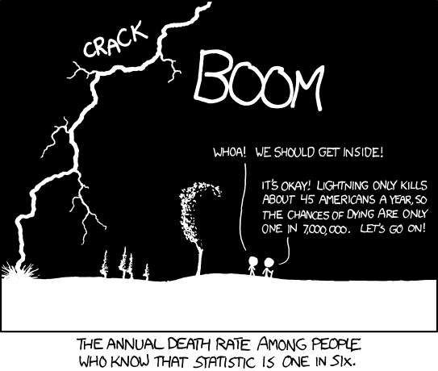

Dear future self,

I've just lost (again) about half an hour of my life trying to find a vaguely remembered formula that generalizes the law of total probability to the case of conditional probabilities. Here it is. You're welcome.

<figure>

<figcaption>

_So what is the probability of dying from a lightning strike if you're an American who knows this statistic?_

</figcaption>

</figure>

The law of total probability says that if you can decompose the set of possible events into disjoint subsets (say $B$ and $\overline{B}$), then (with obvious generalization to more than two subsets):

$$\Pr(A) = \Pr(A \mid B) \Pr(B) + \Pr(A \mid \overline{B}) \Pr(\overline{B})$$

But what if you're dealing with $\Pr(A \mid C)$ instead of just $\Pr(A)$? What's the formula for the law of total probability in that case? What you're searching for can be found by googling for "total law probability conditional":

$$\Pr(A \mid C) = \Pr(A \mid B, C) \Pr(B \mid C) + \Pr(A \mid \overline{B}, C) \Pr(\overline{B} \mid C)$$

More generally, for any mutually exclusive and exhaustive partition $B_1, B_2, \dots, B_n$ of the sample space:

$$\Pr(A \mid C) = \sum_{i=1}^n \Pr(A \mid B_i, C) \Pr(B_i \mid C)$$

The rule of thumb is simple: **every probability in the unconditional formula picks up $C$ on the right-hand side of the conditioning bar.**

## Three-line derivation

You don't need to memorize the formula if you remember how to derive it from the definition of conditional probability, $\Pr(X \mid Y) = \frac{\Pr(X, Y)}{\Pr(Y)}$ (assuming $\Pr(C) > 0$):

1. Write $\Pr(A \mid C)$ as a ratio and split the joint event $(A, C)$ across the disjoint sets $B$ and $\overline{B}$:
   $$\Pr(A \mid C) = \frac{\Pr(A, C)}{\Pr(C)} = \frac{\Pr(A, B, C) + \Pr(A, \overline{B}, C)}{\Pr(C)}$$
2. Factor each numerator term using the chain rule $\Pr(A, B, C) = \Pr(A \mid B, C)\Pr(B \mid C)\Pr(C)$:
   $$\Pr(A \mid C) = \frac{\Pr(A \mid B, C)\Pr(B \mid C)\Pr(C) + \Pr(A \mid \overline{B}, C)\Pr(\overline{B} \mid C)\Pr(C)}{\Pr(C)}$$
3. Cancel $\Pr(C)$ from the numerator and denominator:
   $$\Pr(A \mid C) = \Pr(A \mid B, C)\Pr(B \mid C) + \Pr(A \mid \overline{B}, C)\Pr(\overline{B} \mid C)$$

(See also [this Math StackExchange thread](https://math.stackexchange.com/questions/2377816/applying-law-of-total-probability-to-conditional-probability) for the same derivation.)

## Two common pitfalls

1. **Forgetting to condition the weights on $C$:** It is tempting to write $\Pr(A \mid B, C)\Pr(B)$ instead of $\Pr(A \mid B, C)\Pr(B \mid C)$. That is only valid when $B$ and $C$ are statistically independent ($\Pr(B \mid C) = \Pr(B)$).
2. **Dropping $C$ from the likelihood term:** Conversely, you can only simplify $\Pr(A \mid B, C)$ to $\Pr(A \mid B)$ when $A$ is conditionally independent of $C$ given $B$ (for instance, when $B$ mediates the entire effect of $C$ on $A$).

## Worked example

In the [xkcd comic](https://xkcd.com/795/) above, suppose we want the probability of being struck by lightning ($A$) given that a thunderstorm is overhead ($C$), and we partition by whether a person stays outdoors ($B$) or goes indoors ($\overline{B}$):

- Given a storm is overhead ($C$), suppose $10\%$ of people stay outdoors ($\Pr(B \mid C) = 0.10$) and $90\%$ go indoors ($\Pr(\overline{B} \mid C) = 0.90$).
- During a storm, suppose the probability of being struck while outdoors is $\Pr(A \mid B, C) = 10^{-4}$, while indoors it is $\Pr(A \mid \overline{B}, C) = 10^{-7}$.

Applying the conditional law of total probability:

$$\begin{aligned}
\Pr(A \mid C) &= \Pr(A \mid B, C)\Pr(B \mid C) + \Pr(A \mid \overline{B}, C)\Pr(\overline{B} \mid C) \\
&= (10^{-4})(0.10) + (10^{-7})(0.90) \\
&= 1.009 \times 10^{-5}
\end{aligned}$$

Notice why conditioning both terms on $C$ matters: on a sunny day, far more than $10\%$ of people might be outdoors ($\Pr(B) \gg \Pr(B \mid C)$), and the risk of lightning without a storm is effectively zero ($\Pr(A \mid B) \ll \Pr(A \mid B, C)$). Conditioning on $C$ must be carried through both factors.
