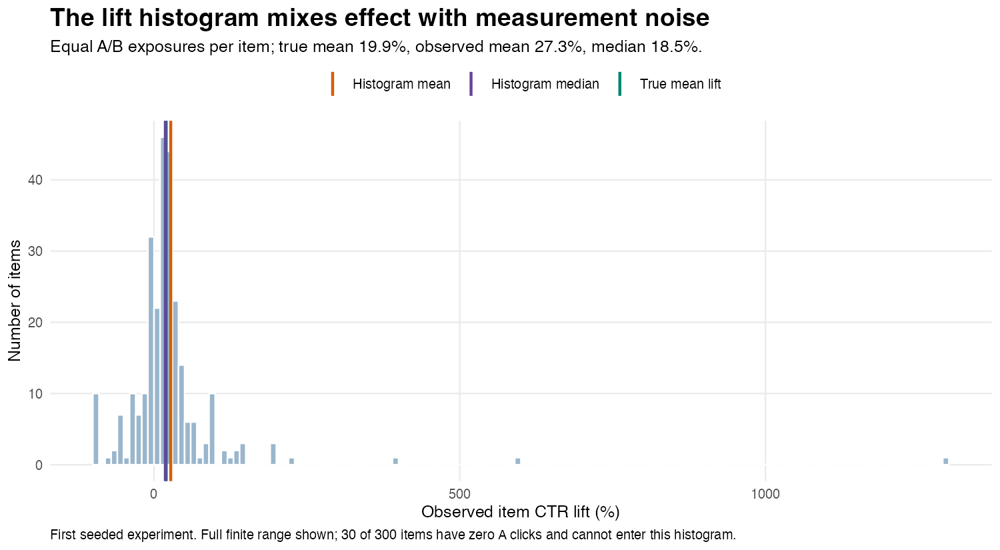
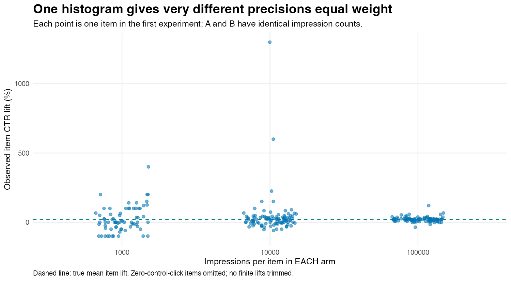
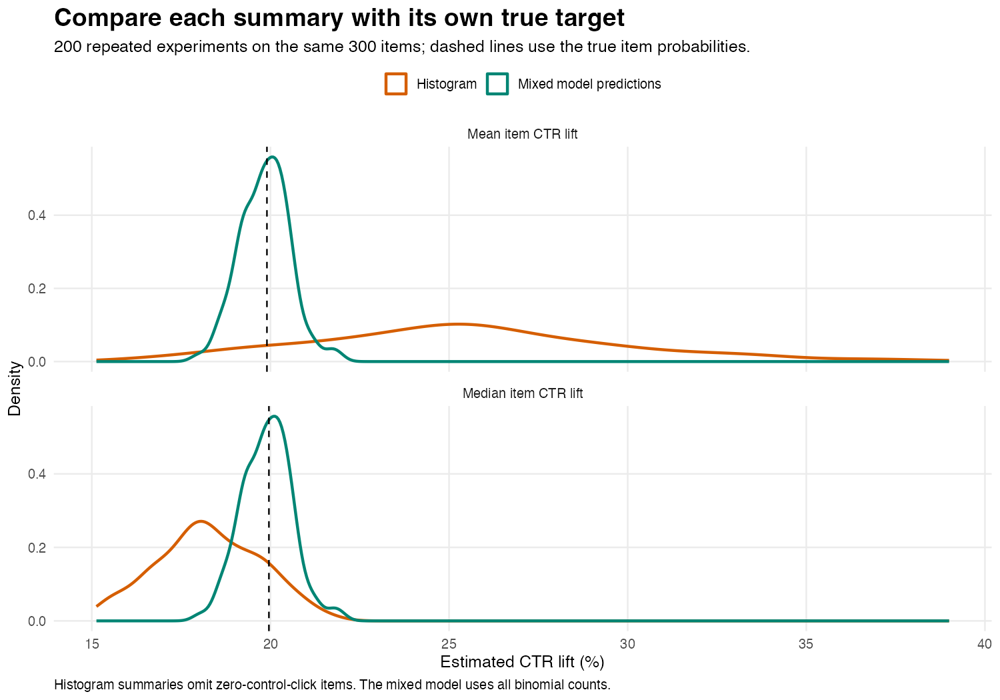

A very common experiment in online commerce consists in trying different variants for an impressed item. (For the sake of this discussion,
let's assume the variants consist of different thumbnails showing the item.) The traditional way of running this experiment consists in randomly
selecting the variant that's shown to the user when the item's impression is requested, and record whether the user clicked on it:

```{mermaid}
flowchart TD
    request["Impression requested for an item"] --> randomize{"Randomly assign variant"}
    randomize -->|50%| a["Select thumbnail A"]
    randomize -->|50%| b["Select thumbnail B"]
    a --> impression["Display and record impression"]
    b --> impression
    impression --> outcome["Record whether the user clicks"]
    outcome --> aggregate["Aggregate clicks and impressions by item and variant"]
    aggregate --> report["Report CTR = clicks / impressions"]
```

You'd like to know if variant B outperforms variant A and by how much. As every item has an equal probability of showing A or B,
and assuming you have enough impressions (say, at least 1000 per arm), it's very tempting to take each item $i$, calculate its click-through rate under algorithms A and B, and plot a histogram of the relative lift,

$$
\widehat L_i = \frac{\widehat{\mathrm{CTR}}_{Bi}}{\widehat{\mathrm{CTR}}_{Ai}}-1,
$$

and use the empirical mean and standard deviation of the $\widehat L_i$ to report the estimated effect and its uncertainty. But there are at least
two problems with this approach:

- this assumes that every $\widehat L_i$ is drawn from the same distribution
- this doesn't address the possibility that the click counts on A are zero

As always, let's simulate to see if I'm just blowing things out of proportion or if this can really happen.


## A constant effect

We simulate 300 items; 100 of them receive 1,000 impressions *per arm*, 100 receive 10,000, and 100 receive 100,000. This is important
because the distribution of $\widehat L_i$ will depend on the distribution of each arm's CTR, which is a binomial distribution
divided by a constant and so will depend on the number of impressions.

We'll also assume a different baseline click probability for each item, modeled with a normally distributed random effect.

Baseline click probabilities vary between items. We generate them with a random-intercept logistic model:

$$
Y_{it}\sim\operatorname{Binomial}(n_i,p_{it}), \qquad
\operatorname{logit}(p_{it})=\alpha+u_i+\beta t,
\qquad u_i\sim N(0,1.2^2),
$$

where $t=0$ for A and $t=1$ for B, $\alpha=\operatorname{logit}(0.002)$, and $\beta=\log(1.2)$. Item intercepts are independent of impression counts. Click counts are independent conditional on the item intercepts.

B multiplies every item's **odds** of a click by exactly 1.2. The effect is constant on the log-odds scale, matching the model we will fit.

A 20% odds increase is not exactly a 20% CTR increase. If $r=\exp(\beta)$, an item's true relative CTR lift is

$$
L_i=\frac{r}{1+(r-1)p_{Ai}}-1.
$$

It depends on baseline CTR. In these simulated items, true mean CTR lift is **19.90%** and true median CTR lift is **19.96%**. We use those exact probability-based targets when judging the histogram, rather than treating odds lift and CTR lift as interchangeable.

## What the histogram says



In the first experiment, the histogram mean is **27.31%**, while its median is **18.49%**. The mixed model's predicted mean CTR lift is **20.38%**.

There are also 30 items missing from that histogram because A recorded no clicks. Twelve have no clicks in either arm, producing $0/0$; the other eighteen have positive B clicks and an infinite observed ratio. We explicitly omit these items from the histogram and report how many. We retain all of them when fitting the model. No finite ratios are trimmed, and no pseudocounts are added.

Three issues are entangled here:

- **The denominator is noisy.** A downward fluctuation in A's observed CTR can produce a very large ratio. An upward fluctuation does not produce a symmetric movement in the opposite direction. The numerator being unbiased does not make the ratio unbiased.
- **Each bar gives items equal representation despite unequal precision.** A ratio based on a few clicks has the same vote in the histogram mean as one based on thousands.
- **Omitting zero denominators selects on the observed outcome.** It changes which items enter the summary. Adding an arbitrary pseudocount would define a different estimator, not eliminate the need to examine its behaviour.

The median is less sensitive to extreme ratios, but it is still the median of noisy, discrete measurements in a selected sample. There is no general identity equating that median with the median of the underlying effects. The directions of the distortions here are simulation results, not universal rules.



## Fit the counts, with an intercept for each item

Instead of summarizing the ratios, fit a binomial logistic regression with a shared treatment coefficient and an item-level random intercept:

```r
library(lme4)
fit <- glmer(
  cbind(clicks, impressions - clicks) ~ arm + (1 | item),
  data = experiment,
  family = binomial,
  nAGQ = 9
)
```

There are two rows per item, one per arm, with `arm` coded 0 for A and 1 for B. The response supplies both clicks and non-clicks. The item intercept represents baseline propensity; the arm coefficient estimates the common conditional log-odds effect. This grouped binomial syntax and random-effects specification are supported by [`lme4::glmer`](https://lme4.github.io/lme4/reference/glmer.html).

The binomial likelihood uses each row's impression count. We do not give a noisy observed ratio the same status as a precise one, nor manually assign weights to ratios. Item intercepts are partially pooled through their shared normal distribution. Zero-click rows remain valid binomial observations.

To report **CTR lift**, predict each observed item's probability under both arms, retaining its fitted random intercept:

$$
\widehat L_i^{\mathrm{model}}
=\frac{\operatorname{logit}^{-1}(\widehat\alpha+\widehat u_i+\widehat\beta)}
{\operatorname{logit}^{-1}(\widehat\alpha+\widehat u_i)}-1.
$$

Then take the mean or median of those predicted lifts, depending on the question. These are plug-in summaries for the observed items, not predictions for a new population of items. Reporting $\exp(\widehat\beta)-1$ directly would instead report the proportional change in odds.

## Repeat the experiment

We hold the 300 items, their probabilities, and their impression counts fixed, then redraw clicks and refit the model 200 times.



| Summary | True target | Average estimate across 200 experiments |
|---|---:|---:|
| Histogram mean | 19.90% mean item lift | 25.49% |
| Model-predicted mean | 19.90% mean item lift | 19.85% |
| Histogram median | 19.96% median item lift | 18.28% |
| Model-predicted median | 19.96% median item lift | 19.90% |

All 200 fits passed the script's convergence and non-singularity checks. The mean estimated log-odds effect was 0.18182, versus the true 0.18232. Approximate 95% Wald intervals for that coefficient covered it in 96.5% of these repetitions. That coverage calculation concerns the log-odds coefficient, not the derived CTR summaries.

## What to report

**Use the binomial counts and model item baselines when estimating the shared conditional algorithm effect. A histogram of observed ratios is an exploratory plot, not a substitute for that analysis.** A logistic model with item random effects does this well in our example.

It would be too strong to claim that this is the *only* way to estimate an effect. For example, with the identical exposure mixes used here, the pooled CTR ratio estimates an impression-level relative effect: its true target is 19.65%, and its average estimate is 19.60%. That is a different target from mean item lift, but it is a legitimate one. Item fixed-effect or conditional logistic approaches can also address a common conditional odds effect under suitable assumptions.

The mixed model succeeds here under a data-generating process that matches its assumptions. A random intercept does not fix audience confounding, dependence from repeated users, or an incorrect assumption of a shared treatment effect. If the treatment effect itself varies between items, random slopes may be needed. If a constant *relative CTR lift* is the scientific assumption, a constant logistic coefficient is not that assumption.

## Reproduce the simulation

Install `ggplot2` and `lme4`, then run from the repository root:

```bash
Rscript scripts/ctr-exposure-simulation.R
```

For the temporary library used to validate this draft locally:

```bash
R_LIBS_USER=/private/tmp/ctr-r-library Rscript scripts/ctr-exposure-simulation.R
```

The seed is `20261010`. Outputs include all three graphs, [each repetition and its model diagnostics](simulation-draws.csv), [summary results](simulation-summary.csv), [the first experiment's item counts and true probabilities](example-items.csv), [the first fitted model](example-model.txt), and [R session information](simulation-session.txt). Repetition one supplies the example histogram; it was not selected from the repetitions for an especially large discrepancy.
